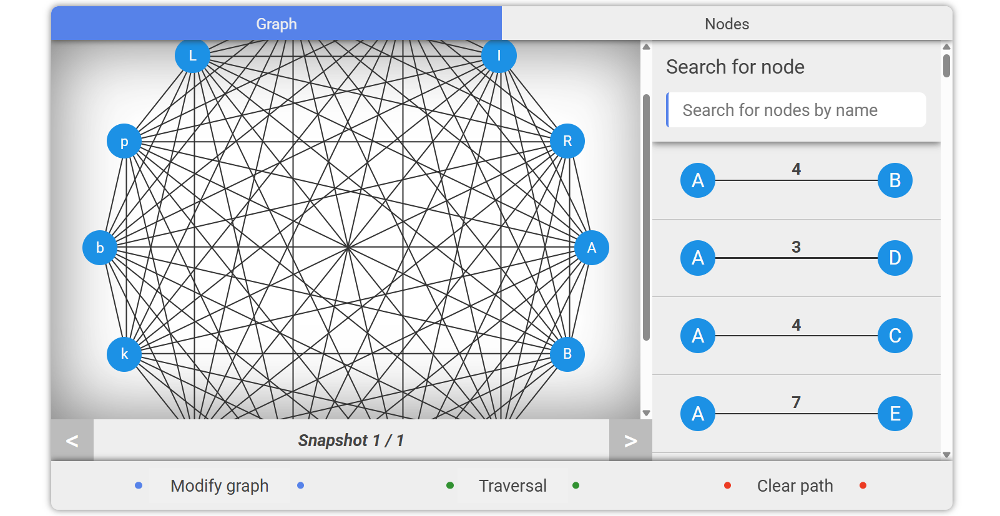

## Graph Representation Library
This is a representation library for `Graph` but the one in `Graph Theory` that is consist of `Node` and `Edges`. I built it to serve some use cases for me in the past. I had a `Shortest Path Problem` with `GUI` and `Travelling Salesman Problem` so I wanted some interactive graph where I can initiate the graph then hit `solve` and specify what I want to solve exactly and after that it will allow me to `navigate` between the nodes as I go (that is `Snapshots`). The thing is I sent a request to the `backend` with all necessary information and the backend built a graph internally and solve the problem then returned to me the solution. You can check the backend from [here](https://github.com/osama78assi/Genetic_Problems_Solutions) So I created this library. After that for each item in the solution a `graph snapshot` is living and I just need to navigate between them



## Usage
it's very simple
install the code

then install the packages
```
npm i
```

You will see an interface that is just for `demonstrating` the graph

## Tech stack
1. React
2. Redux

## License

This project is open source and licensed under the [MIT License](LICENSE).
